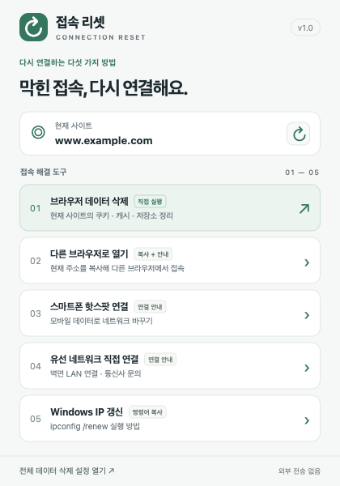

# 접속 리셋 · Connection Reset

접속 문제를 해결할 때 사용하는 다섯 가지 방법을 버튼으로 모은 한국어 Chrome 확장 프로그램입니다. Manifest V3 / Chrome 109 이상을 대상으로 만들었습니다. 별도 빌드, 로그인, 서버가 필요하지 않습니다.



## 설치하기

1. [Releases](../../releases)에서 `connection-reset.zip`을 받아 압축을 풉니다. (또는 이 저장소를 그대로 받아도 됩니다)
2. Chrome 주소창에 `chrome://extensions`를 입력합니다.
3. 오른쪽 위 **개발자 모드**를 켭니다.
4. **압축해제된 확장 프로그램을 로드합니다**를 누릅니다.
5. 압축을 푼 폴더 중 **manifest.json이 들어 있는 connection-reset 폴더**를 선택합니다.
6. 툴바의 퍼즐 모양 확장 프로그램 메뉴에서 **접속 리셋**을 고정합니다.
7. 문제가 있는 웹사이트를 열고 확장 아이콘을 누릅니다.

ZIP 파일이나 popup.html을 직접 여는 방식으로는 설치되지 않습니다. 설치 폴더는 삭제하거나 이동하지 마세요. 파일을 수정한 뒤에는 확장 관리 화면의 새로고침 버튼을 누르면 됩니다.

## 다섯 가지 버튼

| 버튼 | 실행되는 동작 |
| --- | --- |
| 브라우저 데이터 삭제 | 삭제 대상을 확인한 후 현재 사이트의 쿠키, HTTP 캐시, Cache Storage, IndexedDB, Local Storage, 서비스 워커, 파일 시스템 저장소를 모든 기간에서 삭제합니다. 선택하면 완료 후 새로고침합니다. |
| 다른 브라우저로 열기 | 현재 주소 전체를 복사합니다. Chrome, Edge, Whale 등 다른 브라우저를 직접 열어 주소창에 붙여넣습니다. |
| 스마트폰 핫스팟 연결 | 스마트폰과 컴퓨터의 연결 절차를 보여줍니다. 연결을 마친 후 새로고침 버튼을 누릅니다. |
| 유선 네트워크 직접 연결 | 직접 연결과 통신사 문의 절차를 보여줍니다. 연결을 마친 후 새로고침 버튼을 누릅니다. |
| Windows IP 갱신 | `ipconfig /renew`를 복사하고 Windows 명령 프롬프트에서 실행하는 방법을 보여줍니다. |

하단 **전체 데이터 삭제 설정 열기**는 Chrome의 인터넷 사용 기록 삭제 설정을 엽니다. 이 버튼 자체는 데이터를 삭제하지 않으며 삭제 범위와 기간은 Chrome 설정에서 선택합니다.

## 삭제 범위와 동작

- 사이트 삭제 버튼은 확인창을 거쳐야 실행됩니다. 로그인 상태, 사이트에 저장한 작업, 오프라인 데이터가 사라질 수 있습니다.
- 저장소와 캐시는 선택한 출처(프로토콜·호스트·포트)로 제한합니다. **쿠키는 Chrome API 특성상 같은 등록 가능 도메인 전체에 영향을 줄 수 있습니다.** 예를 들어 www.example.com을 삭제하면 login.example.com의 쿠키에도 영향을 줄 수 있습니다.
- 방문 기록, 저장된 비밀번호, 북마크와 확장 프로그램 데이터는 이 버튼으로 삭제하지 않습니다. 설치형 보호 웹 앱의 저장소는 삭제 대상에 포함하지 않습니다.
- 확인 후 탭이 다른 출처로 이동했다면 삭제를 거부합니다. 삭제 후 다른 출처로 이동했다면 새로고침을 생략합니다.
- 팝업을 닫아도 삭제 요청은 백그라운드에서 처리됩니다. 실행 중 상태와 마지막 결과는 브라우저 세션 동안만 저장합니다. 브라우저 종료나 백그라운드 중단으로 결과를 확정할 수 없는 경우 이를 안내하며 삭제를 자동 반복하지 않습니다.
- Chrome 내부 페이지, 새 탭, 로컬 파일에서는 사이트 삭제·주소 복사·새로고침이 비활성화됩니다. 안내와 전체 삭제 설정은 사용할 수 있습니다.

## 자동화할 수 있는 범위

일반 Chrome 확장 프로그램에는 다른 브라우저 앱 실행, Wi-Fi 변경, LAN 케이블 연결, 운영체제 명령 실행 권한이 없습니다. 따라서 2~5번은 사용자의 직접 조작을 돕는 안내 또는 복사 기능입니다. `ipconfig /renew`를 버튼 한 번으로 실제 실행하려면 별도 Windows 프로그램과 Native Messaging 설치가 추가로 필요하며, 이 버전에는 포함하지 않았습니다.

`ipconfig /renew`는 자동 IP 할당(DHCP)의 구성을 갱신합니다. 같은 주소가 재할당될 수 있고, 공유기 내부 IP 갱신이 인터넷에서 보이는 공인 IP 변경을 뜻하지는 않습니다. 핫스팟이나 유선 직접 연결도 공인 IP 변경 또는 접속 문제 해결을 보장하지 않습니다. VPN이나 공인 IP 조회 기능은 포함하지 않습니다.

## 권한과 개인정보

| 권한 | 용도 |
| --- | --- |
| activeTab | 확장 아이콘을 눌렀을 때 현재 탭 주소와 삭제 대상을 확인합니다. |
| browsingData | 확인한 사이트의 쿠키·캐시·저장소를 삭제합니다. Chrome이 넓은 데이터 삭제 권한으로 표시할 수 있으나 코드에서 출처를 제한합니다. |
| clipboardWrite | 사용자가 버튼을 눌렀을 때 주소 또는 명령어를 복사합니다. 클립보드의 기존 내용은 해당 텍스트로 교체됩니다. |
| storage | 진행 중인 작업과 마지막 결과를 Chrome의 세션 메모리에 저장합니다. |

외부 서버, 분석 도구, 원격 스크립트, 호스트 전체 접근 권한, 페이지 삽입 스크립트를 사용하지 않습니다. 방문 기록을 수집하거나 서버로 전송하지 않습니다. 주소 복사 기능은 쿼리와 해시를 포함한 전체 URL을 복사하되, 주소에 들어 있는 아이디·비밀번호(user:pass@)는 제거합니다.

## 파일 구성

- `manifest.json`: 확장 정보, 권한, 팝업 및 서비스 워커 등록
- `popup.html`, `popup.css`, `popup.js`: 한국어 화면과 버튼 처리
- `core.js`: 대상 URL 검증, 삭제 범위, 연결 안내
- `reset-service.js`: 삭제 상태와 동시 실행 제어
- `background.js`: Chrome API 연결
- `icons/`: 확장 아이콘
- `tests/`: 실제 데이터를 삭제하지 않는 자동 검증과 Chrome API 모의 객체

## 검증

Node.js 22 이상에서 폴더 안의 다음 명령으로 테스트합니다.

```sh
node --test tests/reset-service.test.mjs
```

19개 자동 테스트는 출처 제한, 내부 페이지 차단, 탭 이동, API 실패, 재시도 범위, 중복 요청, 새로고침 옵션, 중단 복구, 주소 속 계정정보 제거, 한글 도메인 표시, 다른 사이트의 지난 결과 숨김, 저장소 오류 복구를 검증합니다. 팝업은 Chromium 화면에서 모의 Chrome API로 버튼·대화상자·오류 표시를 검증했습니다. **실제 Chrome 확장 설치, 실제 쿠키 삭제, Windows 명령 실행은 이 환경에서 검증하지 않았습니다.** 중요한 작업이 없는 테스트 사이트에서 설치 후 동작을 확인하세요.

## 참고한 공식 문서

- [Chrome browsingData API](https://developer.chrome.com/docs/extensions/reference/api/browsingData)
- [Microsoft ipconfig 명령](https://learn.microsoft.com/en-us/windows-server/administration/windows-commands/ipconfig)
